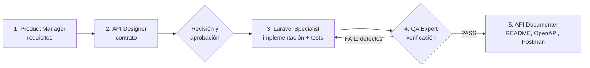
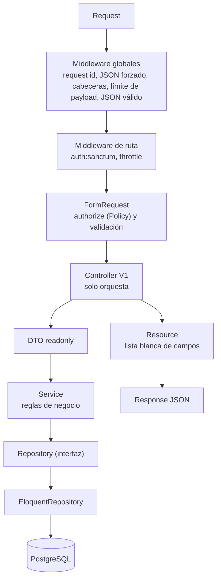

# Beos Products API

API REST para gestionar **productos con precio base y precios en otras divisas**. Autenticación con tokens Bearer (Laravel Sanctum), roles `admin` (lectura y escritura) y `viewer` (solo lectura), documentación OpenAPI 3.1 interactiva y colección Postman.

- Base URL: `/api/v1` (local: `http://localhost:8000/api/v1`)
- 7 endpoints, los del enunciado: CRUD de productos y listado y alta de precios por divisa. Todos exigen token.

## Contenido

[Proceso de ingeniería](#proceso-de-ingeniería) · [Stack](#stack) · [Requisitos](#requisitos) · [Instalación](#instalación) · [Probar el proyecto](#probar-el-proyecto) · [Usuarios y tokens demo](#usuarios-y-tokens-demo) · [Uso rápido](#uso-rápido) · [Endpoints](#endpoints) · [Respuestas y errores](#respuestas-y-errores) · [Seguridad](#seguridad-implementada) · [Arquitectura](#arquitectura) · [Tests y calidad](#tests-y-calidad) · [Documentación](#documentación) · [Decisiones de negocio](#decisiones-de-negocio) · [Puntos de mejora](#puntos-de-mejora) · [Observaciones sobre el enunciado](#observaciones-sobre-el-enunciado)

## Proceso de ingeniería

El proyecto se construyó con un flujo por fases. Cada fase la ejecutó un rol especializado y dejó un entregable versionado. Ninguna fase avanzaba sin que la anterior estuviera aprobada.



| Fase | Rol | Qué se hizo | Entregable |
|---|---|---|---|
| 1. Requisitos | Product Manager | Análisis del enunciado. Historias de usuario con criterios Given/When/Then. Resolución de ambigüedades como reglas de negocio `RN-xx`. Requisitos no funcionales y priorización MoSCoW. | [`docs/01-requirements.md`](docs/01-requirements.md) |
| 2. Diseño | API Designer | Arquitectura en capas, contrato por endpoint, formato estándar de respuestas y errores, seguridad, esquema PostgreSQL y estrategia de tests. | [`docs/02-api-design.md`](docs/02-api-design.md) |
| 3. Revisión | Responsable del proyecto | Aprobación de la especificación antes de escribir código. | — |
| 4. Implementación | Laravel Specialist | Código según el contrato, con tests feature y unit contra PostgreSQL real. Pint y Larastan quedan en verde. | `app/`, `database/`, `tests/` |
| 5. QA | QA Expert | Ejecución de la suite y trazabilidad criterio por criterio. Auditoría de seguridad y pruebas exploratorias contra un servidor real. | Informe PASS/FAIL |
| 6. Documentación | API Documenter | README, OpenAPI exportado y colección Postman con tests automáticos. | Este README, [`docs/openapi.json`](docs/openapi.json), [`docs/postman/`](docs/postman/) |

**Ciclo QA.** La ronda 1 dio **FAIL** con 8 defectos. Tres eran altos: errores 500 provocados por entrada del usuario.
- Un token Bearer con id fuera del rango `bigint`.
- UTF-8 inválido en `search` o en `name`.
- Un byte NUL en el password del login, que además permitía enumerar usuarios (el login se retiró después por alcance).

Cada defecto se corrigió con su test de regresión (`TokenFormatTest`, `MalformedInputTest`, `TrustedHostTest`, `RoutesTest`). La ronda 2 dio **PASS**. Las decisiones que se apartan del diseño original están en [`docs/02-api-design.md` §10](docs/02-api-design.md).

**Cambio de alcance.** Después de la ronda 2 se redujo la API a los 7 endpoints del enunciado. `POST /auth/login`, `POST /auth/logout`, `GET /currencies` y `PUT /products/{id}/prices/{currency_id}` llegaron a implementarse y probarse, y se retiraron con todo su código y sus tests. Sanctum, las abilities, las Policies y el rate limit siguen protegiendo los 7 endpoints. Ver [Puntos de mejora](#puntos-de-mejora).

**Estado final verificado:**

| Comprobación | Resultado |
|---|---|
| `php artisan migrate:fresh --seed` | OK (6 migraciones, 5 divisas, 2 usuarios, 2 tokens demo y 4 productos) |
| `php artisan test` | 344 tests, 1964 assertions, 0 fallos |
| Cobertura (Xdebug) | 99,7 % de líneas sobre todo `app/`; 100 % en `Services`, `Http` y `Repositories` |
| `pint --test` | OK |
| PHPStan / Larastan nivel 6 | 0 errores, sin baseline |
| `route:list --path=api/v1` | exactamente 7 rutas |
| Colección Postman (Newman) | 28 requests, 83 assertions, 0 fallos |

**Principios aplicados.**
- **Escalabilidad sin sobreingeniería.** Los repositorios van detrás de interfaces, así que se puede añadir caché con un decorator sin tocar los Services.
- **Versionado.** La capa HTTP está versionada (`V1`) y el dominio no.
- **Configuración.** Los límites se configuran por `.env`.
- **Datos.** La integridad la garantizan constraints de PostgreSQL: CHECK, UNIQUE y FK RESTRICT.

## Stack

| Componente | Versión (según `composer.lock`) |
|---|---|
| PHP | `^8.4.1` (desarrollado con 8.5) |
| Laravel | 13.40 |
| PostgreSQL | desarrollado y probado con 18 |
| Laravel Sanctum | 4.3 |
| Scramble (OpenAPI 3.1) | 0.13 |
| PHPUnit / Pint / Larastan | 12.5 / 1.32 / 3.14 (nivel 6) |

## Requisitos

- PHP 8.4.1 o superior (lo exigen las dependencias del `composer.lock`) con la extensión `pdo_pgsql` (más las extensiones habituales de Laravel).
- PostgreSQL en ejecución.
- Composer 2.

## Instalación

1. Descargar el proyecto e instalar las dependencias:

```bash
git clone <url-del-repositorio> beos-products-api
cd beos-products-api
composer install
cp .env.example .env        # Windows PowerShell: Copy-Item .env.example .env
php artisan key:generate
```

2. Crear las dos bases de datos. La de test se migra sola al ejecutar los tests.

```bash
createdb -U postgres beos_products
createdb -U postgres beos_products_test
# o en psql: CREATE DATABASE beos_products; CREATE DATABASE beos_products_test;
```

3. Ajustar `DB_USERNAME` y `DB_PASSWORD` en `.env`. Por defecto son `postgres` y vacío. El mismo usuario sirve para las dos bases.

4. Migrar con datos de ejemplo y levantar el servidor:

```bash
php artisan migrate --seed
php artisan serve
```

La API queda en `http://localhost:8000/api/v1` y la UI de documentación en `http://localhost:8000/docs/api`.

`migrate --seed` crea las tablas, las divisas USD, EUR, GBP, COP y MXN (tipos de cambio ilustrativos), los usuarios demo y un token demo por usuario. El seeder imprime los tokens completos.

También crea 4 productos de ejemplo, con valores fijos, para probar los listados, filtros y precios sin cargar datos a mano. No se crean con `APP_ENV=production`.

| id | Producto | Precio base | Precios en otras divisas |
|---|---|---|---|
| 1 | Wireless Mouse | 25.99 USD | EUR, COP |
| 2 | Mechanical Keyboard | 89.00 USD | EUR, GBP, MXN |
| 3 | USB-C Hub | 45.00 EUR | USD |
| 4 | Laptop Stand | 120000.00 COP | ninguno |

## Probar el proyecto

Hay cuatro formas, de la más automática a la más manual.

**1. Suite automatizada** (no necesita el servidor levantado):

```bash
composer check                          # Pint + Larastan + 344 tests
```

**2. Cobertura** (requiere Xdebug o PCOV):

```bash
# bash
XDEBUG_MODE=coverage php artisan test --coverage --min=80
# PowerShell
$env:XDEBUG_MODE='coverage'; php artisan test --coverage --min=80
```

**3. Colección Postman contra el servidor real** (con `php artisan serve` en marcha):

```bash
php artisan migrate:fresh --seed        # parte de datos limpios: ids de token 1 y 2, de divisa 1 a 5
npx newman run docs/postman/beos-products-api.postman_collection.json \
  -e docs/postman/local.postman_environment.json
```

También se puede importar la colección en Postman y ejecutarla con el Collection Runner. Ver [Documentación](#documentación).

**4. A mano.** Abre `http://localhost:8000/docs/api`, pega el [token demo](#usuarios-y-tokens-demo) completo en la autenticación Bearer de "Try it" y lanza las peticiones. También puedes usar los `curl` de [Uso rápido](#uso-rápido).

## Usuarios y tokens demo

No hay login: la API se consume con tokens. `UserSeeder` crea los dos usuarios y **un token por usuario** con el secreto de `DEMO_ADMIN_TOKEN` / `DEMO_VIEWER_TOKEN` (`.env.example`). **No se ejecuta con `APP_ENV=production`.**

El valor que se envía en `Authorization: Bearer ...` es `{id}|{secreto}`. En una base recién sembrada (`migrate:fresh --seed`) los ids de token son `1` y `2`:

| Usuario | Rol | Abilities | Valor completo del token |
|---|---|---|---|
| `admin@example.com` | admin | `products:read`, `products:write` | `1\|f5f96bf7e681a84fabed161e3128cf8d8a1a9a81fce644f4` |
| `viewer@example.com` | viewer | `products:read` | `2\|a6b35176fab24e259108a0b9e86b468ea6d2f7c3c3766407` |

- Los tokens demo **no caducan** (`expires_at` nulo) y solo existen fuera de producción. Re-sembrar es idempotente: conserva el id y, si cambia el secreto del `.env`, reemplaza el valor.
- El rol `viewer` solo puede leer: escribir devuelve `403`.
- Si la base ya tenía tokens, los ids pueden ser otros: el seeder imprime los valores completos (`Demo admin token: 1|...`).

**Emitir un token propio** (también en producción):

```bash
php artisan api:token admin@example.com --name=evaluador
# imprime solo el token completo, p. ej. 3|kZ3x9aPlainTextToken
```

El token lleva las abilities del rol del usuario y caduca a las 8 h (`API_TOKEN_TTL_MINUTES`). Si el email no existe, el comando falla con código de salida 1.

## Uso rápido

Con la base recién sembrada, los ids de divisa son USD `1`, EUR `2`, GBP `3`, COP `4` y MXN `5` (orden del seeder; no hay endpoint de divisas).

```bash
export TOKEN='1|f5f96bf7e681a84fabed161e3128cf8d8a1a9a81fce644f4'   # admin demo

curl -X POST http://localhost:8000/api/v1/products \
  -H "Authorization: Bearer $TOKEN" -H 'Content-Type: application/json' \
  -d '{"name":"Laptop Pro 14","price":"1299.90","currency_id":1,"tax_cost":"249.00","manufacturing_cost":"800.00"}'

curl -X POST http://localhost:8000/api/v1/products/1/prices \
  -H "Authorization: Bearer $TOKEN" -H 'Content-Type: application/json' \
  -d '{"currency_id":2,"price":"1199.00"}'

curl http://localhost:8000/api/v1/products/1/prices -H "Authorization: Bearer $TOKEN"

curl "http://localhost:8000/api/v1/products?search=lap&sort=-price" -H "Authorization: Bearer $TOKEN"
```

Las peticiones con body deben enviar `Content-Type: application/json`.

## Endpoints

Rutas relativas a `/api/v1`. Todas requieren `Authorization: Bearer <token>`.

| Método | Ruta | Ability | Éxito | Descripción |
|---|---|---|---|---|
| GET | `/products` | `products:read` | 200 | Lista paginada con filtros y orden |
| POST | `/products` | `products:write` | 201 | Crea un producto (cabecera `Location`) |
| GET | `/products/{id}` | `products:read` | 200 | Detalle con su divisa base |
| PUT | `/products/{id}` | `products:write` | 200 | Reemplazo total (no existe `PATCH`) |
| DELETE | `/products/{id}` | `products:write` | 204 | Borrado lógico |
| GET | `/products/{id}/prices` | `products:read` | 200 | Precios en otras divisas, ordenados por código de divisa |
| POST | `/products/{id}/prices` | `products:write` | 201 | Registra el precio en una divisa (`Location` apunta al listado de precios) |

La escritura exige además el rol `admin`: un token `viewer` nunca puede escribir

## Respuestas y errores

- Éxito: `{ "data": ... }`. `GET /products` añade `links` y `meta` de paginación.
- Montos como string (`"1299.90"`) y fechas ISO 8601 UTC. `DELETE` responde `204`; los `POST` responden `201` con `Location`.
- Todo error usa el mismo formato. `errors` solo aparece en `422`, y `request_id` es igual a la cabecera `X-Request-Id`:

```json
{ "message": "The given data was invalid.", "code": "validation_error",
  "errors": { "price": ["The price field must be at least 0.01."] }, "request_id": "9f1c2b7e-..." }
```

| HTTP | `code` | Cuándo |
|---|---|---|
| 400 | `bad_request` | JSON malformado o `Host` no confiable |
| 401 | `unauthenticated` | Token ausente, inválido o expirado |
| 403 | `forbidden` | Rol o ability insuficiente |
| 404 | `not_found` | Recurso inexistente o eliminado |
| 405 | `method_not_allowed` | Método no soportado (p. ej. `PATCH`) |
| 409 | `conflict` | Precio duplicado en una divisa |
| 413 | `payload_too_large` | Body mayor de 64 KB |
| 422 | `validation_error` | Datos inválidos |
| 429 | `too_many_requests` | Límite de peticiones superado |
| 500 | `server_error` | Error inesperado, sin trace ni SQL |

## Seguridad implementada

- **Autenticación:** tokens Bearer de Sanctum en los 7 endpoints. La API no usa sesión ni cookies.
- **Autorización:** las Policies exigen el rol y la ability del token, y se evalúan antes que la validación.
- **Rate limit:** 60 peticiones por minuto por usuario.
- **Entrada:** FormRequests, `#[Fillable]` y DTOs contra mass assignment. Se rechazan el UTF-8 inválido, los bytes NUL, el JSON roto y los bodies de más de 64 KB.
- **SQL injection:** solo Eloquent con bindings. `sort` va por lista blanca y `search` escapa los comodines.
- **Base de datos:** restricciones `CHECK`, `UNIQUE` y claves foráneas `RESTRICT`.
- **Salida:** Resources con lista blanca de campos y errores sin stack trace.
- **Cabeceras y CORS:** cabeceras de seguridad (nosniff, DENY, CSP, no-store), CORS restringido y solo se acepta el host de `APP_URL`.

## Arquitectura



## Tests y calidad

Los tests usan PostgreSQL real (`beos_products_test`) y nunca tocan `beos_products`.

```bash
composer check      # Pint + Larastan nivel 6 + tests
```

## Documentación

- **UI interactiva:** `http://localhost:8000/docs/api`.
- **OpenAPI 3.1:** [`docs/openapi.json`](docs/openapi.json).
- **Postman:** [colección](docs/postman/beos-products-api.postman_collection.json) y [entorno](docs/postman/local.postman_environment.json). Trae los tokens demo. La carpeta **Products** tiene los 7 endpoints y **Error cases** los casos de error.
- **Requisitos y diseño:** [`docs/01-requirements.md`](docs/01-requirements.md) y [`docs/02-api-design.md`](docs/02-api-design.md).

## Decisiones de negocio

- Las divisas se cargan con el seeder (USD 1, EUR 2, GBP 3, COP 4, MXN 5).
- Un producto tiene como máximo un precio por divisa; registrar otro en la misma divisa responde `409`.
- No se admite un precio adicional en la divisa base del producto (`422`).
- `DELETE` es un borrado lógico y `PUT` reemplaza el producto completo.
- `exchange_rate` es solo un dato de referencia; los precios no se convierten automáticamente.
- `admin` lee y escribe; `viewer` solo lee.

## Puntos de mejora

Quedaron fuera del alcance de los 7 endpoints. Todo lo marcado con (*) llegó a implementarse y probarse, y se retiró para ajustarse al enunciado.

- **Autenticación (\*).** `POST /auth/login` y `POST /auth/logout` con rate limit estricto (5 intentos por minuto por email e IP), mensaje único y comprobación de hash de igual coste para evitar la enumeración de usuarios. Hoy los tokens salen del seeder o de `php artisan api:token`. También faltan revocar tokens por comando o endpoint, rotación y gestión de usuarios.
- **`GET /currencies` (\*).** Lista de divisas para que el cliente descubra los `currency_id`. Hoy dependen del orden del seeder.
- **Precios.** `PUT /products/{id}/prices/{currency_id}` para corregir un precio (\*) y `DELETE` para eliminarlo. Sin ellos, un precio mal registrado no se puede arreglar por la API.
- **CRUD de divisas** y sincronización de `exchange_rate` con un proveedor externo.
- **Conversión automática.** Un campo calculado `suggested_price` con `exchange_rate` y bcmath, nunca persistido (RN-13). Requiere definir antes la divisa de referencia del tipo de cambio.
- **Caché del repositorio.** Un decorator `CachedProductRepository` que se activa cambiando solo el binding en `RepositoryServiceProvider`; los repositorios ya están preparados.
- **Restaurar productos** eliminados y `PATCH` parcial.
- **Búsqueda.** Índice `pg_trgm` GIN para acelerar `ILIKE '%x%'` con muchos productos.
- **Rate limit previo a la autenticación.** Hoy el limiter `api` corre después de `auth:sanctum`, así que las peticiones con un token inválido (401) no consumen cuota. Falta un limiter por IP antes de autenticar.
- **Auditoría.** Registrar quién creó, modificó o eliminó cada producto y precio (`created_by`/`updated_by` o una tabla de eventos).
- **Concurrencia.** `ETag`/`If-Match` en `PUT` para evitar que una actualización pise a otra. También un bloqueo para la carrera entre cambiar la divisa base y registrar un precio en esa divisa (RN-05), hoy aceptada como riesgo.
- **Endurecimiento del servidor.** `expose_php=Off` para no enviar `X-Powered-By`.
- **Operación.** Workflow de CI (Pint, Larastan y tests), Docker/Sail, `trustProxies` configurado, métricas y logs estructurados, `Deprecation`/`Sunset` al introducir `/api/v2`.

## Observaciones sobre el enunciado

Hallazgos al analizar *Prueba Backend.pdf*, comprobados contra el documento. Cada uno indica cómo se resolvió.

**Errores y erratas del documento**

1. **Tabla Divisas, campo `name`.** Su descripción es "Identificador único de la divisa", igual que la de `id`. Parece una errata: `name` debería ser el nombre. Se tomó como nombre legible y único (`US Dollar`) y se añadió `code` (ISO 4217) como identificador inequívoco.
2. **Tabla Precios de productos, campo `id`.** Su descripción también es "Identificador único de la divisa", cuando debería ser el identificador del precio. Se tomó como id del precio.
3. **Encabezado duplicado.** En Divisas aparece una línea suelta "Campo Tipo Descripción" justo encima del encabezado de la propia tabla.
4. **Mayúsculas inconsistentes.** El campo es `Price` en Productos (el resto va en minúscula y snake_case) y el tipo de `currency_id` es `Integer` en Precios (en las demás tablas, `integer`). Se usan `price` e `integer`.

**Ambigüedades y huecos del modelo**

5. **Sin endpoint de divisas.** `currency_id` es obligatorio, pero el enunciado no incluye ningún endpoint para consultar divisas, así que el cliente no puede conocer los ids. Se resolvió con ids deterministas del seeder (USD 1, EUR 2, GBP 3, COP 4, MXN 5), documentados aquí y en Postman. `GET /currencies` llegó a implementarse y quedó como mejora.
6. **Sin endpoint para corregir o eliminar un precio.** Solo existen `GET` y `POST` de precios. Un precio mal registrado no se puede arreglar por la API.
7. **Precio en la divisa base y duplicados sin definir.** No dice si se permite un precio adicional en la divisa base del producto ni qué pasa al registrar dos veces la misma divisa. Se decidió: base `422` (RN-04) y duplicado `409` (RN-03, con índice único).
8. **Autenticación sin definir.** El criterio de evaluación Seguridad pide "medidas de seguridad adecuadas para proteger los datos", pero el enunciado no define cómo autenticar. Se usó Sanctum con tokens Bearer, abilities por rol y rate limit, y los tokens salen del seeder o de `php artisan api:token`.
9. **`exchange_rate` sin referencia.** "Tasa de cambio de la divisa" no indica la divisa base ni la dirección. Se asumió unidades de esa divisa por 1 USD y se trata como dato de referencia: no se usa para convertir precios (RN-13).
10. **Tipos sin precisión ni restricciones.** `decimal` sin escala y `description` como `string` sin longitud máxima ni nulabilidad (aunque "cada producto debe tener" descripción). Se fijó `numeric(15,2)` para dinero y `numeric(18,6)` para el tipo de cambio, y `description` opcional de hasta 2000 caracteres.
11. **Comportamientos sin especificar.** El enunciado no define el borrado (se eligió borrado lógico), la paginación, el formato de errores ni los códigos HTTP. Se decidieron y están en [`docs/01-requirements.md`](docs/01-requirements.md) y [`docs/02-api-design.md`](docs/02-api-design.md).
12. **Orientación contradictoria.** El texto dice que es una prueba sencilla "que se presta para hacerse rápido" y a la vez "No solo hacerlo con lo mínimo". Se optó por un alcance exacto de 7 endpoints con una implementación completa en estructura, seguridad, tests y documentación.
