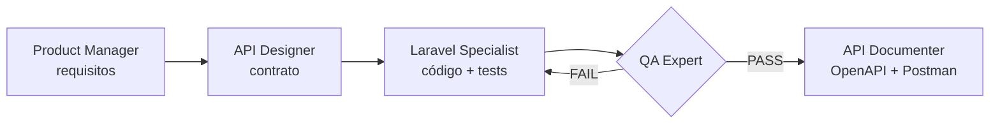
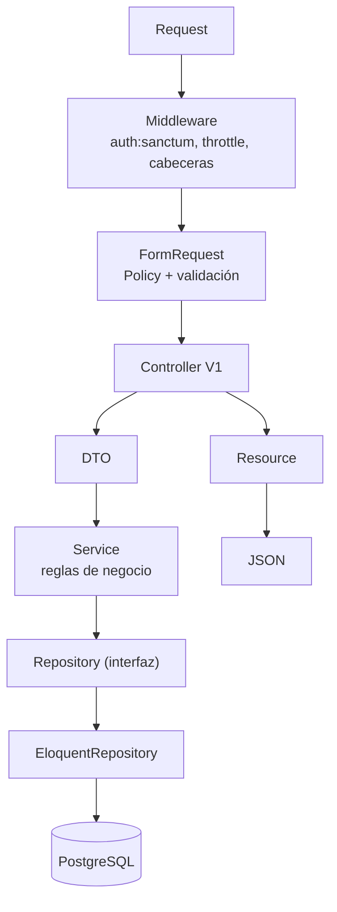

# Beos Products API

API REST en Laravel 13 y PostgreSQL para gestionar productos con un precio base y precios en otras divisas. Expone los 7 endpoints del enunciado bajo `/api/v1`, todos protegidos con tokens Bearer (Sanctum).

## Proceso de ingeniería



Cada fase dejó su entregable: [requisitos](docs/01-requirements.md), [diseño](docs/02-api-design.md), código, informe de QA y documentación.

La primera ronda de QA encontró 8 defectos y todos se corrigieron con su test de regresión.

Estado final verificado:
- 344 tests en verde.
- 99,7 % de cobertura.
- PHPStan nivel 6 sin errores.
- Colección Postman sin fallos.

## Requisitos

- PHP 8.4.1 o superior con la extensión `pdo_pgsql`.
- PostgreSQL.
- Composer 2.

## Instalación

```bash
git clone <url-del-repositorio> beos-products-api && cd beos-products-api
composer install
cp .env.example .env            # PowerShell: Copy-Item .env.example .env
php artisan key:generate
```

Crea las bases `beos_products` y `beos_products_test`, y pon `DB_USERNAME` y `DB_PASSWORD` en `.env`. Luego:

```bash
php artisan migrate:fresh --seed
php artisan serve
```

La API queda en `http://localhost:8000/api/v1` y la documentación interactiva en `http://localhost:8000/docs/api`.

El seed carga:
- 5 divisas: USD 1, EUR 2, GBP 3, COP 4, MXN 5.
- 4 productos de ejemplo con precios en otras divisas.
- 2 usuarios con su token.

## Tokens

No hay login. El seed crea un token por usuario. Estos valores son válidos tras `migrate:fresh --seed`:

| Usuario | Puede | Token |
|---|---|---|
| admin | leer, **crear**, editar y eliminar | `1\|f5f96bf7e681a84fabed161e3128cf8d8a1a9a81fce644f4` |
| viewer | solo leer | `2\|a6b35176fab24e259108a0b9e86b468ea6d2f7c3c3766407` |

Para emitir otro token: `php artisan api:token admin@example.com`.

## Probar

- **Tests:** `composer check` ejecuta Pint, Larastan y los tests contra PostgreSQL. No necesita el servidor levantado.
- **Postman:**
  1. Importa [la colección](docs/postman/beos-products-api.postman_collection.json) y [el entorno](docs/postman/local.postman_environment.json). Los tokens ya vienen cargados: `token` es el admin y sirve para crear productos.
  2. Ejecuta la carpeta **Products**, que tiene los 7 endpoints.
  3. Ejecuta la carpeta **Error cases**.
- **Desde la terminal:** `npx newman run docs/postman/beos-products-api.postman_collection.json -e docs/postman/local.postman_environment.json`.

## Endpoints

| Método | Ruta | Descripción |
|---|---|---|
| GET | `/products` | Lista paginada (`search`, `currency_id`, `min_price`, `max_price`, `sort`, `per_page`) |
| POST | `/products` | Crear producto |
| GET | `/products/{id}` | Ver producto |
| PUT | `/products/{id}` | Actualizar producto (reemplazo total) |
| DELETE | `/products/{id}` | Eliminar producto (borrado lógico) |
| GET | `/products/{id}/prices` | Precios del producto en otras divisas |
| POST | `/products/{id}/prices` | Registrar precio en una divisa |

Todas las respuestas son JSON. Los errores siempre tienen la forma `{ message, code, errors?, request_id }`.

## Seguridad

- **Autenticación:** tokens Sanctum en todos los endpoints.
- **Autorización:** Policies por rol y ability del token.
- **Rate limit:** 60 peticiones por minuto por usuario.
- **Validación:** FormRequests y protección contra mass assignment.
- **SQL:** solo Eloquent con bindings, y `sort` por lista blanca.
- **Base de datos:** restricciones `CHECK`, `UNIQUE` y claves foráneas.
- **Errores:** nunca muestran stack trace.
- **HTTP:** cabeceras de seguridad, CORS restringido y host de confianza.

## Arquitectura



## Decisiones de negocio

- Un producto tiene un solo precio por divisa: si se registra otro en la misma divisa, la API responde `409`.
- No se admite un precio adicional en la divisa base del producto: la API responde `422`.
- `exchange_rate` es solo un dato de referencia; los precios no se convierten.
- `admin` lee y escribe; `viewer` solo lee.

## Puntos de mejora

- **Login/logout** con rate limit y **`GET /currencies`**. Llegaron a implementarse y se retiraron para ceñirse a los 7 endpoints.
- **Editar y eliminar precios**, y CRUD de divisas.
- **Conversión automática** de precios con `exchange_rate`.
- **Caché del repositorio** con un decorator.
- **Auditoría** de cambios.
- **Control de concurrencia** (`ETag`).
- **Rate limit por IP** antes de autenticar.
- **CI** y **Docker**.

## Observaciones sobre el enunciado

- En Divisas, `name` aparece descrito como "Identificador único de la divisa". En Precios, el `id` tiene esa misma descripción.
- El campo `Price` está en mayúscula y en Divisas hay un encabezado duplicado.
- `currency_id` es obligatorio, pero el enunciado no incluye ningún endpoint para consultar las divisas.
- No hay endpoint para corregir o eliminar un precio.
- No define autenticación, aunque la prueba evalúa seguridad.
- No indica respecto a qué divisa se expresa `exchange_rate`.
